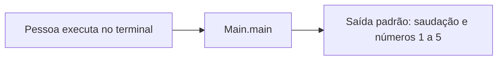
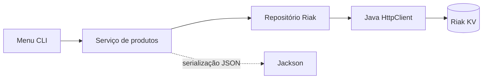

# StockKV

Aplicação Java de linha de comando (CLI) proposta para estudar o gerenciamento de produtos com o Riak KV. **No estado atual do repositório, o projeto ainda não implementa o gerenciamento de produtos nem a integração com Riak**: ele contém apenas o programa inicial gerado pelo IDE e uma classe de teste vazia. Este README descreve esse estado com precisão e apresenta conceitos e exemplos didáticos para orientar a evolução.

## 1. Introdução e objetivo

O objetivo indicado para StockKV é servir como exercício de persistência de produtos em um banco NoSQL distribuído, acessado por uma aplicação Java pura executada no terminal. O código presente ainda não alcança esse objetivo: `Main` imprime “Hello and welcome!” e os números de 1 a 5, sem menu, produtos, persistência ou comunicação com banco.

Por isso, os comandos de execução abaixo executam somente o esqueleto atual. Os exemplos de CRUD, HTTP, JSON e Riak são **ilustrações para estudo**, não funcionalidades disponíveis no programa.

## 2. Tecnologias utilizadas

| Tecnologia | Evidência no repositório | Uso atual |
|---|---|---|
| Java | `pom.xml` define compilação fonte/alvo 21 | `Main` é uma classe Java simples |
| Maven | `pom.xml` declara o artefato `com.stockkv:StockKV:1.0-SNAPSHOT` | Gerenciamento do projeto e compilação |
| JUnit 5 | Não consta no `pom.xml` | Não configurado; classe de teste vazia |
| Riak KV | Não há configuração, cliente ou código de integração | Não conectado |
| Java HttpClient | Não há uso no código | Não implementado |
| Jackson | Não há dependência no `pom.xml` | Não implementado |
| Docker | Não há `Dockerfile` nem `compose.yaml` | Não configurado pelo projeto |

O projeto é Java sem framework web. Não há Spring, Spring Boot, controllers ou servidor HTTP da aplicação. A referência a HTTP neste material trata exclusivamente de uma possível comunicação cliente com o **servidor Riak**.

## 3. Arquitetura e responsabilidades das classes

### Arquitetura encontrada



### Arquitetura pretendida para uma evolução

O desenho seguinte é uma sugestão didática, não um retrato de classes que já existam.



| Classe/parte | Situação | Responsabilidade atual ou sugerida |
|---|---|---|
| `com.stockkv.Main` | Existe | Ponto de entrada `main`; Não contém CLI de produtos. |
| `ProductServicesTest` | Existe, vazia | Não contém testes ou asserções. Apesar do nome, não prova comportamento de serviços. |
| Serviço de produtos | Não existe | Separaria regras de aplicação e validações do fluxo de terminal. |
| Repositório/cliente Riak | Não existe | Poderia encapsular operações HTTP e acesso a buckets/keys. |
| Modelo `Product` | Não existe | Poderia representar os campos de produto e sua conversão JSON. |

Uma separação entre CLI, serviço e repositório manteria entrada/saída do terminal afastada dos detalhes HTTP, mas ainda precisa ser implementada.

## 4. Estrutura de diretórios

```text
StockKV/
├── pom.xml
└── src/
    ├── main/java/com/stockkv/
    │   └── Main.java
    └── test/java/com/stockkv/
        └── ProductServicesTest.java
```

Não há diretórios de recursos, arquivos de configuração Riak, modelos, serviços, repositórios ou scripts Docker no conteúdo analisado. Arquivos de configuração do IDE e `.gitignore` existem, mas não fazem parte da lógica da aplicação.

## 5. Conceitos do Riak KV

Esta seção é material de estudo sobre o banco; não significa que StockKV já o utilize.

### NoSQL

NoSQL é uma família de bancos que oferece modelos de dados diferentes do modelo relacional tradicional. Riak KV é orientado a objetos chave-valor: a aplicação escolhe como representar o conteúdo, em vez de depender de tabelas e junções relacionais. Isso não elimina a necessidade de modelagem: definir chaves, buckets, índices e tratamento de conflitos continua sendo responsabilidade do projeto.

### Key-Value

Uma entrada é endereçada por um espaço (bucket) e uma chave (key), e contém um valor (value):

```text
bucket = "products"
key    = "p-1001"
value  = { "id": "p-1001", "name": "Teclado", "price": 149.90 }
```

O value pode ser um blob opaco para o Riak. JSON é uma escolha da aplicação, não uma exigência do banco.

### Buckets

Bucket é um namespace virtual para agrupar objetos e propriedades de comportamento. Pode ser entendido, com cautela, como um agrupamento lógico; não equivale a uma tabela relacional com esquema rígido. Em versões modernas do Riak, propriedades são tipicamente organizadas com bucket types. O bucket `products` acima é apenas exemplo e não está configurado no projeto.

### Keys e Values

A key identifica um objeto dentro do bucket. Escolher uma key determinística (por exemplo, um identificador de produto) torna a leitura e atualização direta. O value guarda o conteúdo. Uma leitura de key ausente deve ser tratada como caso esperado pelo cliente; a aplicação atual não faz essa operação.

### Replicação

Riak mantém cópias de dados em múltiplas partições/nós para tolerar falhas. A propriedade `n_val` determina o número-alvo de réplicas de um objeto (a documentação de configuração lista 3 como valor padrão comum). Réplica não é backup: exclusões, corrupção lógica ou erro de aplicação podem se propagar.

### Distribuição de dados

O cluster divide o espaço de chaves em partições organizadas em um anel. Hash consistente mapeia um objeto para partições e nós responsáveis. Assim, os dados são distribuídos pelo cluster; uma aplicação cliente não precisa escolher manualmente o nó que guarda cada objeto.

### Consistência eventual

Em um sistema distribuído disponível durante falhas de rede, réplicas podem ficar temporariamente divergentes. Com a troca e reconciliação de atualizações, espera-se que converjam quando as condições permitirem. Portanto, uma leitura logo após gravações concorrentes ou durante partição pode não corresponder a uma visão global única. O comportamento depende das propriedades e parâmetros configurados.

### Quorum

`R`, `W` e `DW` controlam quantas réplicas precisam responder a uma leitura, aceitar uma escrita e confirmar persistência durável, respectivamente. `quorum` é um valor simbólico calculado a partir de `N` (tipicamente `N/2 + 1`). Quoruns maiores tendem a exigir mais respostas e podem afetar disponibilidade/latência. Não se deve confundir resposta de escrita (`W`) com confirmação durável (`DW`). O programa não define nenhum desses parâmetros.

### Siblings

Quando atualizações concorrentes não podem ser ordenadas causalmente, podem existir vários valores para o mesmo bucket/key: siblings. Com `allow_mult` habilitado, o cliente pode receber as versões concorrentes e precisa reconciliá-las conforme a regra do domínio, enviando o resultado com o contexto causal apropriado. Escolher silenciosamente “o último” pode perder alterações. StockKV ainda não trata siblings.

### Secondary Indexes

Secondary indexes (2i) associam valores indexáveis a objetos para buscas por atributos além da key, como `category_bin = "peripherals"` ou `price_int` dentro de um intervalo. São índices simples, com limitações de consulta e requisitos de backend documentados pelo Riak; não equivalem a consultas SQL arbitrárias. Não existe índice ou busca por atributo implementado neste projeto.

## 6. Integração Java com Riak

### Java HttpClient

O Java 21 inclui `java.net.http.HttpClient`, que pode enviar requisições HTTP sem framework web ou cliente de terceiros. O código atual não cria um `HttpClient`; o exemplo abaixo apenas ilustra uma futura leitura do endpoint HTTP do **Riak**:

```java
var client = java.net.http.HttpClient.newHttpClient();
var request = java.net.http.HttpRequest.newBuilder()
    .uri(java.net.URI.create("http://localhost:8098/buckets/products/keys/p-1001"))
    .header("Accept", "application/json")
    .GET()
    .build();

var response = client.send(request,
    java.net.http.HttpResponse.BodyHandlers.ofString());
System.out.println(response.statusCode());
System.out.println(response.body());
```

Esse exemplo não faz parte de `Main` e não foi testado contra uma instância Riak. Em aplicações reais, encode bucket e key corretamente para URL, configure timeout e trate interrupções e falhas de rede.

### Requisições HTTP

O Riak disponibiliza uma API HTTP para operações no banco. Em configurações usuais, a porta HTTP é `8098`. Por exemplo, uma leitura segue o padrão `/buckets/{bucket}/keys/{key}` e uma gravação usa `PUT` nessa localização. A API HTTP pertence ao servidor Riak; StockKV não expõe endpoints nem é um servidor web.

Exemplo ilustrativo com `curl` para uma instância local:

```bash
curl -i http://localhost:8098/buckets/products/keys/p-1001
```

Uma instância recém-iniciada não terá necessariamente esse objeto. O código de status e o corpo devem ser interpretados conforme a operação e a versão/configuração do Riak.

### Jackson e serialização JSON

Jackson é uma biblioteca Java popular para converter objetos Java em JSON e JSON em objetos Java. **Não está declarada como dependência**, então os exemplos a seguir exigiriam adicionar dependências e código antes de compilar:

```java
// Exemplo didático: requer Jackson Databind no pom.xml.
ObjectMapper mapper = new ObjectMapper();
String json = mapper.writeValueAsString(product);
Product decoded = mapper.readValue(json, Product.class);
```

JSON de exemplo:

```json
{
  "id": "p-1001",
  "name": "Teclado",
  "price": 149.9,
  "quantity": 12
}
```

É necessário decidir tipos, validação, campos ausentes, compatibilidade entre versões e conversão entre o modelo de domínio e o formato armazenado.

### Tratamento de respostas e erros

O exemplo de `HttpClient` mostra o status e o corpo, mas não trata erros. Uma implementação deve distinguir ao menos: sucesso HTTP, key inexistente, erro do servidor, timeout/falha de conexão, JSON inválido e interrupção da thread. Também deve evitar assumir que todo corpo de resposta contém um produto. Para escritas e exclusões, validar o status esperado e registrar contexto útil sem expor dados sensíveis. Não há tratamento de respostas ou erros Riak no código atual.

## 7. Instalação e configuração

### Java e Maven no Debian/Linux

O `pom.xml` requer Java 21. Em Debian que disponibilize esses pacotes nos repositórios configurados:

```bash
sudo apt update
sudo apt install -y openjdk-21-jdk maven
java -version
mvn -version
```

Se a versão 21 não estiver disponível na versão do Debian em uso, instale um JDK 21 por um fornecedor compatível e confirme que `JAVA_HOME` e `PATH` apontam para ele. O projeto não inclui Maven Wrapper funcional/documentado.

### Docker e inicialização do Riak

O repositório não fornece uma imagem nem arquivo Compose para Riak. A imagem comunitária `basho/riak-kv` aparece em exemplos de execução, mas não é produzida nem fixada por este projeto. A disponibilidade e compatibilidade dessa imagem precisam ser verificadas no ambiente. Exemplo para estudo, sujeito a essa disponibilidade:

```bash
docker run -d --name riak-kv \
  -p 8098:8098 \
  basho/riak-kv
docker logs -f riak-kv
```

Quando o container estiver pronto, verifique o serviço HTTP:

```bash
curl -i http://localhost:8098/ping
```

O processo de inicialização pode variar conforme imagem e versão. Para ambiente real, consulte a documentação de instalação da versão escolhida; não exponha portas sem controles de rede apropriados.

### Configuração de conexão

Não há propriedades, variáveis de ambiente ou arquivo de configuração lidos pela aplicação. Para os exemplos, `http://localhost:8098` é um endereço ilustrativo compatível com a porta HTTP padrão documentada do Riak. A futura implementação deveria externalizar ao menos host/base URL e timeouts, evitando fixá-los no código.

## 8. Como executar pelo terminal

Na raiz do projeto, compile com Maven:

```bash
mvn clean package
```

Execute a classe compilada:

```bash
java -cp target/classes com.stockkv.Main
```

Saída esperada do esqueleto atual:

```text
Hello and welcome!i = 1
i = 2
i = 3
i = 4
i = 5
```

Não existe menu interativo ou conexão Riak ao iniciar.

## 9. Manual de utilização do menu CLI

**Não há menu CLI implementado**, portanto não existem opções para selecionar. Ao executar, o programa apenas imprime a mensagem e os cinco valores. Um menu de cadastro, consulta, atualização e exclusão é uma funcionalidade pendente, não deve ser considerado disponível.

## 10. Exemplos de cadastro, consulta, atualização e exclusão

Os exemplos desta seção ilustram como uma futura aplicação poderia usar a API HTTP do Riak. Eles não são comandos do menu StockKV.

### Cadastro (gravação)

```bash
curl -i -X PUT \
  -H 'Content-Type: application/json' \
  --data '{"id":"p-1001","name":"Teclado","price":149.9,"quantity":12}' \
  http://localhost:8098/buckets/products/keys/p-1001
```

### Consulta

```bash
curl -i -H 'Accept: application/json' \
  http://localhost:8098/buckets/products/keys/p-1001
```

### Atualização

Uma escrita em Riak substitui o value associado à localização conforme contexto/propriedades aplicáveis. Um cliente deve ler, alterar e gravar com cuidado diante de atualizações concorrentes.

```bash
curl -i -X PUT \
  -H 'Content-Type: application/json' \
  --data '{"id":"p-1001","name":"Teclado mecânico","price":219.9,"quantity":8}' \
  http://localhost:8098/buckets/products/keys/p-1001
```

### Exclusão

```bash
curl -i -X DELETE \
  http://localhost:8098/buckets/products/keys/p-1001
```

Os resultados dependem do estado do servidor, da versão e das propriedades do bucket. Esses exemplos demonstram a API do banco; não comprovam um CRUD implementado em Java.

## 11. Testes com JUnit 5

Não há dependência JUnit no `pom.xml`, e `src/test/java/com/stockkv/ProductServicesTest.java` contém apenas a declaração vazia da classe. Portanto, o projeto ainda não possui testes JUnit 5 implementados. `mvn test` pode compilar/executar o ciclo Maven, mas não valida operações de produto ou Riak.

Um teste futuro poderia verificar regras do serviço isolando o repositório; testes de integração separados poderiam verificar comunicação com uma instância Riak. O exemplo abaixo é apenas ilustrativo e não compila no projeto atual sem adicionar JUnit 5 e a classe `Product`:

```java
@Test
void produtoMantemIdentificadorENome() {
    var product = new Product("p-1001", "Teclado", 149.90, 12);

    assertEquals("p-1001", product.id());
    assertEquals("Teclado", product.name());
}
```

## 12. Exercícios sobre Riak KV

Os exercícios são propostas de estudo, não recursos já construídos.

### Básicos

1. Explique a diferença entre bucket, key e value usando um produto como exemplo.
2. Com `curl`, grave um JSON em uma key e depois consulte essa mesma key.
3. Descubra o comportamento da consulta quando a key não existe.
4. Explique por que o Riak não precisa entender o esquema interno do JSON armazenado.

### Intermediários

1. Crie objetos com keys diferentes para categorias distintas e compare a consulta direta por key com uma consulta por 2i.
2. Pesquise `n_val`, `R`, `W` e `DW`; descreva como mudar os quoruns pode afetar disponibilidade e latência.
3. Investigue como `allow_mult` pode produzir siblings e desenhe uma regra de reconciliação adequada a estoque.
4. Identifique o backend necessário para 2i na versão do Riak escolhida e registre as limitações.

### Avançados

1. Monte um cluster de múltiplos nós em ambiente isolado e acompanhe distribuição e replicação de uma key.
2. Simule indisponibilidade de nó e compare operações com diferentes quoruns.
3. Produza atualizações concorrentes da mesma key e implemente uma reconciliação explícita, sem descartar silenciosamente um sibling.
4. Projete testes de integração reproduzíveis e avalie consistência eventual, read repair, índices e recuperação após falhas.

## 13. Possíveis melhorias

Estas são lacunas observadas ou caminhos de evolução, não funcionalidades existentes:

- Implementar um menu CLI com leitura de entrada, validação e saída compreensível.
- Criar modelo de produto e definir campos, formatos e regras de validação.
- Implementar operações de cadastro, consulta, atualização e exclusão.
- Separar interface CLI, serviço de aplicação e acesso a dados.
- Adicionar um cliente Riak com Java `HttpClient`, timeouts, URL encoding e configuração externa.
- Incluir Jackson (ou outra solução) e definir serialização JSON compatível.
- Tratar status HTTP, objetos ausentes, falhas de rede, respostas inválidas e siblings.
- Definir bucket/type, política de replicação, quoruns e estratégia para índices de acordo com o caso de uso.
- Adicionar JUnit 5, testes unitários e testes de integração controlados.
- Documentar/automatizar ambiente local de Riak e fixar versões reproduzíveis.
- Melhorar mensagens e formatação da saída atual do programa inicial.

## 14. Referências oficiais

- [Documentação oficial do Riak KV — instalação](https://docs.riak.com/riak/kv/latest/setup/installing/index.html)
- [Documentação oficial do Riak KV — API HTTP](https://docs.riak.com/riak/kv/latest/developing/api/http/index.html)
- [Documentação oficial do Riak KV — configuração e propriedades](https://docs.riak.com/riak/kv/latest/configuring/reference/index.html)
- [Documentação oficial do Riak KV — buckets](https://docs.riak.com/riak/kv/2.1.4/learn/concepts/buckets/)
- [Documentação oficial do Riak KV — siblings e contexto causal](https://docs.riak.com/riak/kv/latest/learn/concepts/causal-context/index.html)
- [Documentação oficial do Riak KV — secondary indexes](https://docs.riak.com/riak/kv/latest/developing/usage/secondary-indexes/index.html)
- [Documentação oficial do Riak KV — quoruns e modelo Dynamo](https://docs.riak.com/riak/kv/latest/learn/dynamo/index.html)
- [Java 21 — `HttpClient`](https://docs.oracle.com/en/java/javase/21/docs/api/java.net.http/java/net/http/HttpClient.html)
- [Jackson — projeto oficial](https://github.com/FasterXML/jackson)
- [JUnit 5 — documentação oficial](https://junit.org/junit5/docs/current/user-guide/)
- [Maven — guia oficial](https://maven.apache.org/guides/)

